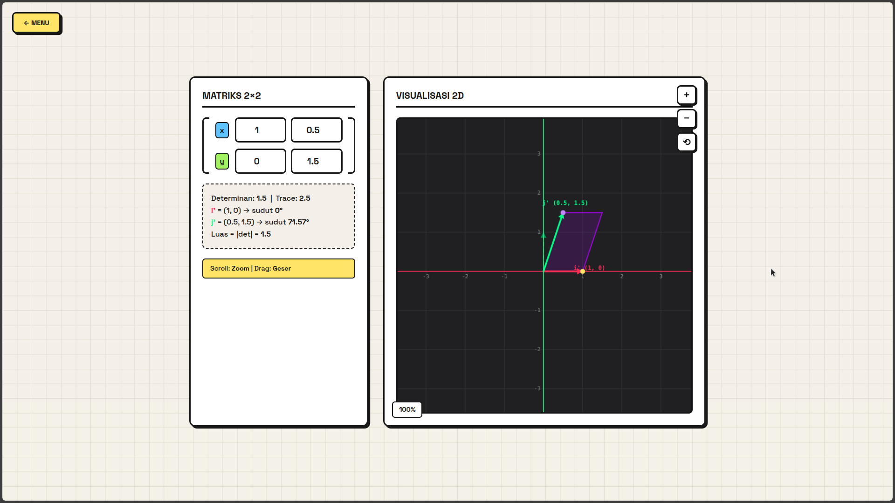

# 🎨 Matriks Lab - Interactive Matrix Visualizer

Visualisasi interaktif untuk mempelajari transformasi matriks **2x2 (2D)** dan **3x3 (3D)** secara *real-time*. Dibuat murni menggunakan **HTML, CSS, dan Vanilla JavaScript** tanpa library eksternal (kecuali font Google).

## ✨ Fitur Utama
- **Mode 2D & 3D**: Pilih dimensi matriks yang ingin dieksplorasi dari menu utama.
- **Live Update**: Grafik langsung berubah saat kamu mengetik angka di kotak matriks.
- **Navigasi Interaktif**: 
  - Mode 2D: Scroll untuk zoom, drag untuk geser.
  - Mode 3D: Drag kiri untuk rotasi, drag kanan untuk geser, scroll untuk zoom.
- **Tema Neo-Brutalism**: Desain visual bergaya buku catatan dengan warna stabilo yang mencolok.
- **Informasi Matematika**: Menampilkan Determinan, Trace, vektor hasil transformasi, hingga Volume/Luas area.

## 🚀 Cara Menjalankan Secara Lokal
Karena ini adalah project murni frontend, kamu cukup mengunduh atau meng-clone repo ini, lalu buka file `index.html` di browser favoritmu (Chrome, Firefox, Safari, dll). Tidak perlu install Node.js atau server lokal.

## 📸 Preview Tampilan

*(Ganti `preview.png` dengan nama file screenshot milikmu setelah kamu menyimpannya di folder ini)*

  

## 🛠️ Teknologi yang Digunakan
- HTML5 Canvas (untuk rendering 2D & 3D)
- CSS3 (Custom Properties, Flexbox, CSS Grid)
- Vanilla JavaScript (Logika Matematika Matriks & Proyeksi 3D)
- Google Fonts (Space Grotesk)

---
*Dibuat untuk eksplorasi aljabar linear yang lebih menyenangkan!*
