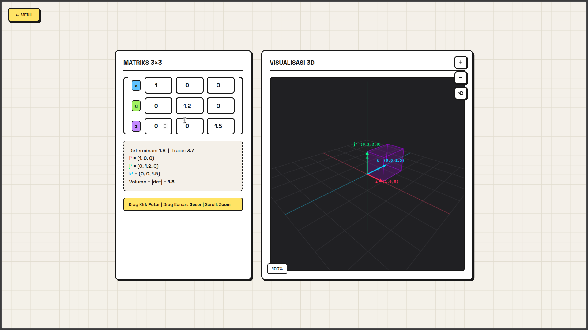

# 🎨 Matriks Lab - Interactive Matrix Visualizer

**"Matriks itu apa sih? Gimana bentuknya ya?"**

Matriks Lab adalah sebuah web interaktif untuk memvisualisasikan transformasi matriks **2x2 (2D)** dan **3x3 (3D)** secara *real-time*. Web ini dibuat untuk membantu siapa saja (pelajar, mahasiswa, atau guru) memahami konsep aljabar linear dengan cara yang lebih menyenangkan dan visual.

## 🚀 Cara Mengakses Webnya

Kamu **tidak perlu** mengunduh kode atau menginstall aplikasi apa pun. Web ini bisa langsung dimainkan di browser kamu (Chrome, Safari, Firefox, dll).

👉 **[KLIK DI SINI UNTUK MEMBUKA WEB MATRIKS LAB](https://aprima123.github.io/matriks-lab/)** 👈

---

## ✨ Fitur Utama
- **Pilih Mode**: Tersedia menu awal untuk memilih eksplorasi Matriks 2D atau 3D.
- **Live Update**: Ubah angka di kotak matriks, dan grafik visualisasinya akan langsung berubah saat itu juga.
- **Navigasi Interaktif**: 
  - **Mode 2D**: *Scroll* untuk *zoom*, dan *Drag* (geser) untuk memindahkan pandangan.
  - **Mode 3D**: *Drag Kiri* untuk memutar objek 3D, *Drag Kanan* untuk menggeser, dan *Scroll* untuk *zoom*.
- **Informasi Matematika**: Menampilkan nilai Determinan, Trace, vektor hasil transformasi, hingga Volume/Luas area secara langsung.
- **Desain Neo-Brutalism**: Tampilan visual bergaya buku catatan dengan warna stabilo yang mencolok dan tidak membosankan.

---

## 📸 Preview Tampilan

**1. Mode 2x2 (Visualisasi 2D)**
*(Lihat bagaimana matriks mengubah bentuk bidang dan arah panah vektor)*

  

 

**2. Mode 3x3 (Visualisasi 3D)**
*(Putar objek untuk melihat bagaimana matriks memanipulasi ruang 3 Dimensi)*

  

---

## 🛠️ Teknologi yang Digunakan
Proyek ini dibuat murni menggunakan teknologi web dasar tanpa *framework* berat, sehingga sangat ringan:
- **HTML5 Canvas** (untuk *rendering* grafik 2D & proyeksi 3D)
- **CSS3** (Custom Properties, Flexbox, CSS Grid untuk desain UI)
- **Vanilla JavaScript** (Logika Matematika Matriks & Proyeksi 3D)
- **Google Fonts** (Space Grotesk)

---
*Dibuat untuk eksplorasi aljabar linear yang lebih menyenangkan!*
